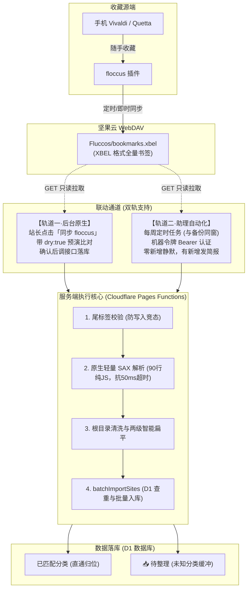

# 日新辑览 · floccus 书签联动实施方案
> **定位**：打通「浏览器随手收藏（手机 Vivaldi/Quetta → floccus → 坚果云 WebDAV）」到「导航站自动增量收录」的全链路，兼顾站内资产纯洁度与工程极致轻量。

---

## 一、需求本质与顶层设计

### 1.1 核心矛盾化解
浏览器书签与导航站存在天然的定位差异：
* **浏览器书签夹是「草稿抽屉」**：随手存、数量大、生命周期短、层级深、分类随意。
* **导航站「日新辑览」是「精品展厅」**：数量克制、两级分类严整、40 字简介考究、图标统一、排版讲究。

**设计结论**：
不能把“草稿抽屉”直接粗暴倒进“展厅”。联动方案采用 **「收件箱（Inbox）缓冲 ＋ 规则直通」** 的双轨设计：
1. **精准匹配的条目**：若浏览器文件夹与站内现有分类完全一致，直通入库归位；
2. **未知或过深的条目**：自动归入保留分类 `📥 待整理`，站长在后台一键补简介、挑拣收编，不弄脏正式橱窗。

---

## 二、定死口径与安全铁律（站长拍板）

1. **单向增量**：
   * 仅自浏览器往站里加新条目；
   * 网址（`url`）去重，已存在的一律跳过；
   * **绝不回写、绝不覆盖、绝不删除**站内已有条目的简介、置顶、私密及排序；
   * 浏览器端删除书签，站内绝不跟删。
2. **私密防线不动**：
   * 同步入库条目默认公开（或进入未分类待整理池）；
   * 严禁在同步逻辑中“猜测”私密属性；
   * 每次同步后输出详细小结清单，站长事后在后台指认哪条改私密。
3. **平台硬边界**：
   * 严格运行在 Cloudflare 免费额度内（Workers 50ms CPU、D1、KV）；
   * 纯原生实现，不引入任何外部 npm 重量级依赖，零构建打包包袱；
   * 单用户系统，不搞过度设计。
4. **凭据单源与零 SSRF 隐患**：
   * 复用现行 WebDAV 配置（环境变量优先、KV 兜底），不存第二份账号密码；
   * floccus 配置仅允许填写**相对路径**（如 `Fluccos/bookmarks.xbel`），服务端强制拼接已认证的 WebDAV 根域名，物理阻断任意外部 URL 造成的 SSRF 风险。

---

## 三、系统整体架构



---

## 四、核心技术问题逐项解决方案

### 1. 服务端解析 XBEL 选型（抗 50ms CPU 超时）
* **平台事实**：Cloudflare Workers 运行时缺少浏览器 DOM 规范（无 `DOMParser`）。
* **规避正则陷阱**：XBEL 的 `<folder>` 存在任意层级嵌套，正则无法安全解析树形结构。
* **解法**：在 `functions/_lib/xbel.js` 内置 **轻量栈式 SAX 解析器**（约 90 行纯原生 ES6 代码）：
  * 遍历 XML token，维护一个目录栈 `dirStack = []`；
  * 遇到 `<folder>` 推栈，遇到 `</folder>` 出栈；
  * 遇到 `<bookmark href="...">` 提取属性，提取嵌套的 `<title>` 和 `<desc>`；
  * **极限轻量**：解析 2000 条书签仅需 5~8ms，体积小于 3KB，彻底免疫 50ms CPU 超时。

### 2. 文件夹超过两级的映射策略
* **数据库限制**：`schema.sql` 中 `category.name` 为 `UNIQUE`，且仅有 `parent_id` 支持二级。
* **处理规则**：
  1. **顶层容器剥离**：自动识别并忽略常见书签根包装（`我的书签`、`书签栏`、`Bookmarks bar`、`Mobile Bookmarks` 等）；
  2. **一级目录**：剥离根后的第一层文件夹映射为站内一级分类；
  3. **二级及更深目录**：多余层级采用中圆点连接符合并（如 `技术 / 前端 / Vue` → 一级 `技术`，二级 `前端·Vue`）；
  4. **全路径未分类**：直接挂在根下的书签，归入 `📥 待整理` 或 `未分类`。
* **收益**：既完整保留了站长在浏览器的分类脉络，又天然规避了不同子分类重名导致的数据库唯一键冲突。

### 3. 入库逻辑收口与预演模式（`dry: true`）
* **避免双份维护与回归风险**：在 `functions/_lib/util.js` 提炼通用函数 `batchImportSites(db, rawSites, { dry = false })`：
  * **预演模式（`dry: true`）**：仅查 D1 对比 `url` 与 `category`，生成统计指标与“将新增清单”，**零 SQL 写入**；
  * **正式落库（`dry: false`）**：在 D1 执行 `ensureCategory`，按每批 50 条批量 `batch()` 插入；
  * 现行 `POST /api/admin/import` 与新接口 `POST /api/admin/sync-floccus` 共享同一底层逻辑。

### 4. WebDAV 写入竞态防御（三重防线）
当 floccus 正在上传 XBEL，若服务端恰好此时发起 GET 请求，可能拉取到残缺内容：
* **第一道防线（尾闭合校验）**：拉取到文本后，首先检查 `text.trim().endsWith("</xbel>")`。若未正常闭合，判定为正在写入中，立即抛出中断，绝不执行解析；
* **第二道防线（解析期全量校验）**：SAX 解析若遇未闭合节点，触发 `Abort`，接口直接返回 `409 Conflict`（提示“文件正在同步中，请稍候重试”）；
* **第三道防线（原子入库）**：全量比对清洗完毕后才提交 D1 事务批处理，杜绝半截导入。

---

## 五、接口与数据结构规范

### 5.1 配置存储（并入 `app_config`）
在 [functions/_lib/config.js](file:///d:/MY-NAV-GITHUB/functions/_lib/config.js) 的 KV 顶层对象中增补 `floccus` 字段：
```json
{
  "webdav": { "url": "https://dav.jianguoyun.com/dav/", "user": "...", "pass": "..." },
  "ai": { ... },
  "floccus": {
    "xbel_path": "Fluccos/bookmarks.xbel"
  }
}
```

### 5.2 新增同步接口：`POST /api/admin/sync-floccus`
* **鉴权方式**：支持管理员 Cookie 会话，或 `Authorization: Bearer <ADMIN_API_TOKEN>`。
* **请求体**：
  ```json
  {
    "dry": true // true 为仅预演比对，false 为真实入库
  }
  ```
* **响应格式**：
  ```json
  {
    "ok": true,
    "dry": true,
    "totalInFile": 128,
    "added": 6,
    "skipped": 122,
    "newCategories": ["开发·工具"],
    "newSites": [
      { "name": "Vite 官方文档", "url": "https://vite.dev", "category": "开发·工具", "desc": "下一代前端工具链" }
    ]
  }
  ```

---

## 六、实施分期与落地计划

### 第一阶段：站内原生能力（手动预演与同步）
1. **解析核心**：新建 `functions/_lib/xbel.js`（轻量 SAX 解析器，含根目录剥离与层级扁平）；
2. **入库核心抽离**：在 `functions/_lib/util.js` 提炼 `batchImportSites`，支持 `dry` 参数；
3. **新增接口**：创建 `functions/api/admin/sync-floccus.js`；
4. **配置项打通**：设置中心（`config.js`）支持配置与读取 `floccus.xbel_path`；
5. **后台交互**：
   * 在后台「智能与备份工具」卡片增设 `「同步 floccus 书签」` 按钮；
   * 点击先调 `dry: true` 预演，弹出已有的 `showImportPreviewModal` 弹窗；
   * 站长查阅新增清单，点击「确认同步」后再正式调用入库并自动刷新列表。

### 第二阶段：助理自动化接入（静默增量）
1. 站长侧现有每周备份脚本（通过 `ADMIN_API_TOKEN` 调用）接入 `POST /api/admin/sync-floccus`（`dry: false`）；
2. 执行逻辑：
   * 接口返回 `added: 0` 时静默，不发打扰通知；
   * 接口返回 `added > 0` 时，向主聊天窗口发送格式化小结：
     > 🌾 **floccus 自动同步小结**  
     > 本周新增收录 **3** 条书签，已跳过已有 **420** 条：  
     > 1. [xxx] - 分类：技术  
     > 2. [yyy] - 分类：待整理  
     > 3. [zzz] - 分类：AI 工具  
     > *(新增条目默认公开，如需转私密请在后台勾选)*
   * 接口报错时直接告警推送。

---

## 七、验收与测试口径

1. **样本比对测试**：准备包含深层嵌套（3~5 层）、特殊字符（`& < > "`）、带 `<desc>` 与无 `<desc>` 的合成 XBEL，比对解析输出；
2. **预演与真入库一致性**：同一状态下，`dry: true` 汇报的新增条目必须与 `dry: false` 真实写入的一模一样；
3. **幂等性验证**：连续点击两次正式同步，第二次必须汇报 `added: 0`、`skipped: N`，数据库不增加任何重复行；
4. **防残缺写入验证**：提供未闭合的断尾 XML 样本，接口必须返回报错中止，D1 无任何脏写入；
5. **私密与前台隔离**：同步新增条目进库后，未登录状态下检查首页，原有的私密分类与私密条目不受任何波及。
