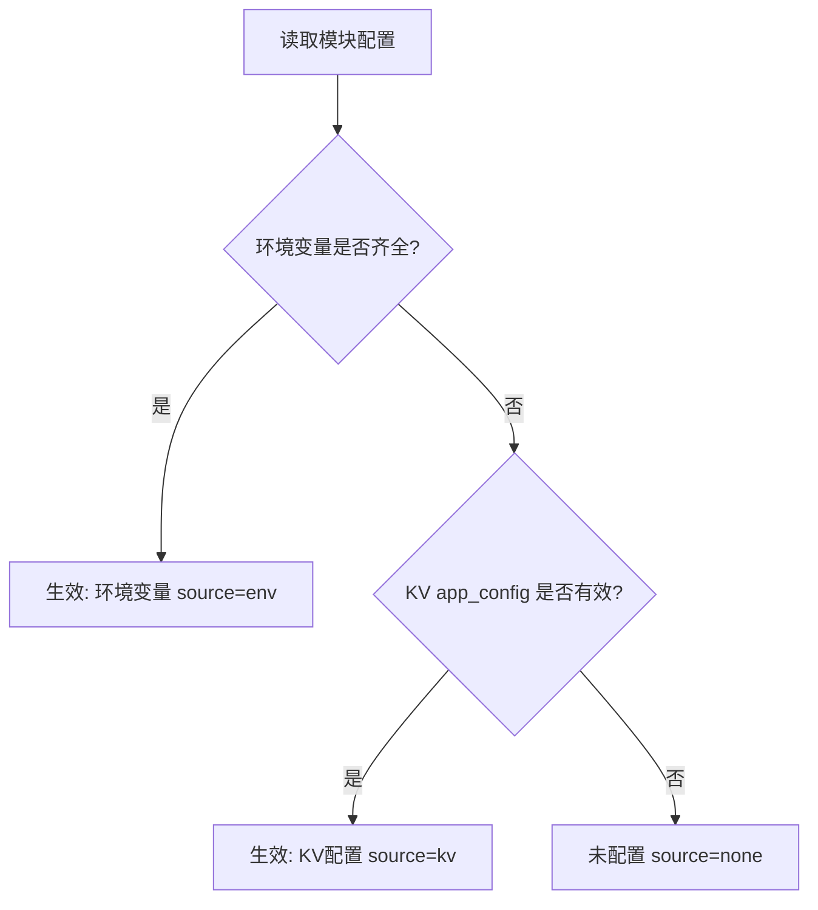

# 日新辑览 · 后台配置功能（WebDAV 备份与 AI 补简介）实施方案

## 一、背景与目标

本站（日新辑览）计划开源。目前 WebDAV 备份与 AI 补简介依赖 Cloudflare Pages 环境变量（`WEBDAV_URL`、`WEBDAV_USER`、`WEBDAV_PASS`、`CF_ACCOUNT_ID`、`CF_AI_TOKEN`）。开源后，非技术背景的自部署用户容易遇到控制台变量配置门槛高、粘贴错误、空值且必须重新部署才生效等痛点。

**目标**：
1. 将 WebDAV 与 AI 两套配置整合进后台管理界面，实现**后台配置、即时生效、当场联调测试**。
2. 遵循**环境变量优先、后台配置兜底**原则，确保已配置环境变量的老用户与现网服务不受任何破坏性影响（行为零变化）。
3. 遵循严格安全规范，绝不向前端回显密钥明文，采用单向掩码展示与增量更新保护。

---

## 二、架构总原则与安全设计

### 1. 存储设计（无 D1 变动）
- **存储介质**：Cloudflare KV（直接复用现有绑定 `NAV_KV`），严禁新建或修改 D1 表结构。
- **存储键名**：`app_config`
- **数据结构**：单一 JSON 对象
```json
{
  "webdav": {
    "url": "https://dav.jianguoyun.com/dav/",
    "user": "username@example.com",
    "pass": "app-specific-password"
  },
  "ai": {
    "provider": "cloudflare",
    "account_id": "cf-account-id-xxx",
    "api_key": "cf-ai-token-xxx",
    "base_url": "",
    "model": "@cf/meta/llama-3.3-70b-instruct-fp8-fast"
  }
}
```

### 2. 优先级机制与生效判定
系统采用双层回退决策树：



- **WebDAV 组**：
  - 环境变量判定：`env.WEBDAV_URL`、`env.WEBDAV_USER`、`env.WEBDAV_PASS` 三者皆非空 $\rightarrow$ 生效 `env`；
  - 否则读取 KV 中 `app_config.webdav` $\rightarrow$ 若有效则生效 `kv`；
  - 否则判定为 `none`。
- **AI 组**：
  - 环境变量判定：`env.CF_ACCOUNT_ID` 与 `env.CF_AI_TOKEN` 两者皆非空 $\rightarrow$ 生效 `env`（服务商固定为 `cloudflare`，模型采用 `@cf/meta/llama-3.3-70b-instruct-fp8-fast`）；
  - 否则读取 KV 中 `app_config.ai` $\rightarrow$ 若有效则生效 `kv`；
  - 否则判定为 `none`。

### 3. 保密与掩码规则
- **读取（GET）**：绝不回显密钥明文。
  - 密钥字段只返回状态标识与后 4 位掩码：`pass_set: boolean`、`pass_mask: string`（如 `••••abcd`，不足 4 位则回 `••••`）；
  - 非敏感字段（地址 `url`、账号 `user`、服务商 `provider`、账户 ID `account_id`、接口地址 `base_url`、模型名 `model`）明文回显。
- **保存（PUT）**：
  - 密钥字段（`pass`、`api_key`）如果传空字符串 `""` 或未传入，表示**保持已有原值不修改**；
  - 只有显式传入 `{ clear: true }` 时，才执行对应模块的配置物理清除。
- **鉴权**：所有后台新接口一律强制通过 `requireAuth(context)`，支持管理员 Session Cookie 与 Bearer 机器令牌。

---

## 三、接口设计规范

### 1. 配置查询与保存：`functions/api/admin/config.js`

#### `GET /api/admin/config`
返回当前生效状态、掩码配置与生效来源。
- **响应示例**：
```json
{
  "webdav": {
    "url": "https://dav.jianguoyun.com/dav/",
    "user": "myuser",
    "pass_set": true,
    "pass_mask": "••••8888"
  },
  "ai": {
    "provider": "google",
    "account_id": "",
    "api_key_set": true,
    "api_key_mask": "••••abcd",
    "base_url": "https://generativelanguage.googleapis.com/v1beta/openai/",
    "model": "gemini-2.5-flash"
  },
  "source": {
    "webdav": "kv",
    "ai": "kv"
  }
}
```

#### `PUT /api/admin/config`
部分增量更新 KV 配置。
- **请求体示例**：
```json
{
  "webdav": {
    "url": "https://dav.jianguoyun.com/dav/",
    "user": "myuser",
    "pass": "newpassword",
    "clear": false
  },
  "ai": {
    "provider": "deepseek",
    "api_key": "",
    "base_url": "https://api.deepseek.com/v1",
    "model": "deepseek-chat",
    "clear": false
  }
}
```
- **校验规则**：
  - `webdav.url` 必须以 `http://` 或 `https://` 开头；
  - `ai.provider` 必须属于枚举：`cloudflare` | `openai` | `google` | `deepseek` | `custom`。

---

### 2. 连通性测试接口

#### `POST /api/admin/config/test-webdav`（`functions/api/admin/config/test-webdav.js`）
- **功能**：接收草稿或已存配置，向目标地址发送 WebDAV 标准 `PROPFIND`（请求头 `Depth: 0`）探测连通性。
- **请求体**：`{ "url": "...", "user": "...", "pass": "..." }`（`pass` 留空则自动读取生效中的已存密码）。
- **结果判定**：
  - `2xx` 或 `207 Multi-Status` $\rightarrow$ 连接成功；
  - `401` 或 `403` $\rightarrow$ 明确提示「账号或密码不对（坚果云请使用专门生成的应用密码，而非网页登录密码）」；
  - 其他状态码 $\rightarrow$ 提示具体 HTTP 状态码。

#### `POST /api/admin/config/test-ai`（`functions/api/admin/config/test-ai.js`）
- **功能**：接收草稿或已存配置，使用固定的样本（斗鱼 `https://www.douyu.com`）执行一次实际生成并返回结果。
- **请求体**：`{ "provider": "...", "account_id": "...", "api_key": "...", "base_url": "...", "model": "..." }`（`api_key` 留空则使用生效中的已存密钥）。
- **结果判定**：
  - 成功 $\rightarrow$ 返回 `{ ok: true, desc: "生成的简介内容" }`；
  - 失败 $\rightarrow$ 返回 `{ ok: false, error: "上游错误信息摘要" }`。

---

## 四、核心模块设计

### 1. 配置管理中心：`functions/_lib/config.js`
- `getKvConfig(env)`：从 KV 读取 `app_config`。
- `getWebdavConfig(env)`：按照 `env` 优先、`KV` 兜底规则解析 WebDAV 配置，返回 `{ url, user, pass, source }` 或 `null`。
- `getAiConfig(env)`：按照 `env` 优先、`KV` 兜底规则解析 AI 配置，返回完整对象或 `null`。
- `maskSecret(str)`：遮蔽密钥，保留末 4 位。

### 2. AI 多协议统一适配器：`functions/_lib/ai.js`
统一导出接口：
```javascript
export async function generateDesc(aiConfig, { title, meta, url })
```

#### 服务商与协议矩阵：
| provider | 显示名称 | 协议类型 | 默认 base_url | 默认 model |
| :--- | :--- | :--- | :--- | :--- |
| `cloudflare` | Cloudflare Workers AI | 原生 Workers AI API | - | `@cf/meta/llama-3.3-70b-instruct-fp8-fast` |
| `openai` | OpenAI | OpenAI Chat 兼容 | `https://api.openai.com/v1` | `gpt-4o-mini` |
| `google` | Google Gemini | OpenAI Chat 兼容 | `https://generativelanguage.googleapis.com/v1beta/openai/` | `gemini-2.5-flash` |
| `deepseek` | DeepSeek | OpenAI Chat 兼容 | `https://api.deepseek.com/v1` | `deepseek-chat` |
| `custom` | 自定义（OpenAI 兼容） | OpenAI Chat 兼容 | 用户自定义 | 用户自定义 |

- **提示词保持现有标准**：
  `网站标题：${title}\n网站描述：${meta || "（无）"}\n网址：${url}\n请用一句简体中文概括这个网站是做什么的，不超过24个字，不要书名号和引号，不要以"这是一个"开头，只输出这句话。`
- **输出截断与标点收尾**：超 24 字时自动在中文标点收尾，避免截出半句话。

---

## 五、现有文件改造方案

1. **`functions/api/admin/backup.js`**：
   - 移除原 `davConfig(env)`，改为 `await getWebdavConfig(env)`；
   - 若未配置返回 503 并提示前往后台设置；
   - 目标文件依然严格保持既有行为：拼装 `rixin-jilan-backup.json`。
2. **`functions/api/admin/restore.js`**：
   - 改走 `await getWebdavConfig(env)`。
3. **`functions/api/admin/ai-desc.js`**：
   - 改走 `await getAiConfig(env)` 配合 `generateDesc`；
   - 严格保留现有的网页 HTML 抓取解析与降级兜底逻辑（AI 失败或未配时，平滑回退到 meta/title 提炼）。
4. **`functions/admin/index.js`**：
   - 在左侧列新增「设置」区块：
     - **WebDAV 设置卡**：坚果云/Nextcloud/自定义快捷填充、地址/账号/密码（带掩码 placeholder）、保存、测试连接按钮、生效来源 Badge。
     - **AI 补简介设置卡**：服务商下拉、字段按需显隐、保存、测试生成按钮、测试效果即时卡内呈现、生效来源 Badge。
   - 保持现有后台原汁原味的宋韵排版、样式变量与 Toast 反馈体系。

---

## 六、实施步骤与提交规划

| 步骤 | 主要任务 | 预期 Git 提交信息 |
| :---: | :--- | :--- |
| **Step 1** | 新建 `functions/_lib/config.js` 与 `functions/_lib/ai.js` 底座 | `feat: 新增后台配置解析与多协议AI适配器模块` |
| **Step 2** | 新建配置及测试接口 `functions/api/admin/config.js` 及子接口 | `feat: 新增后台配置读写与WebDAV/AI连通性测试接口` |
| **Step 3** | 改造业务接口 `backup.js`、`restore.js`、`ai-desc.js` | `refactor: 备份恢复与AI补简介接入统一配置解析` |
| **Step 4** | 改造后台界面 `functions/admin/index.js`，增加设置卡与测试交互 | `feat: 后台新增WebDAV与AI设置卡片及快捷预设当场测试` |
| **Step 5** | 代码全局语法审查、括号闭合自查，推送到 `origin/main` | `docs: 完善后台配置功能与开源自部署说明`（若有文档补充） |

---

## 七、验证清单

- [ ] 现网已有环境变量时，来源展示为「环境变量」，业务请求零异常；
- [ ] 后台保存 KV 后，接口仅下发掩码，不泄露明文；
- [ ] 坚果云应用密码错误时，返回精准友好的中文排查指引；
- [ ] OpenAI / Google / DeepSeek 协议请求正常通过，斗鱼测试用例正常返回一句话中文简介；
- [ ] 备份与恢复功能正常读写 WebDAV 文件。
